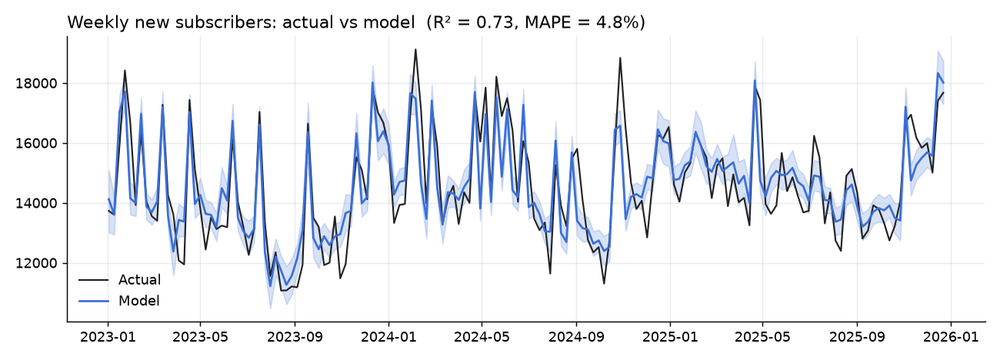
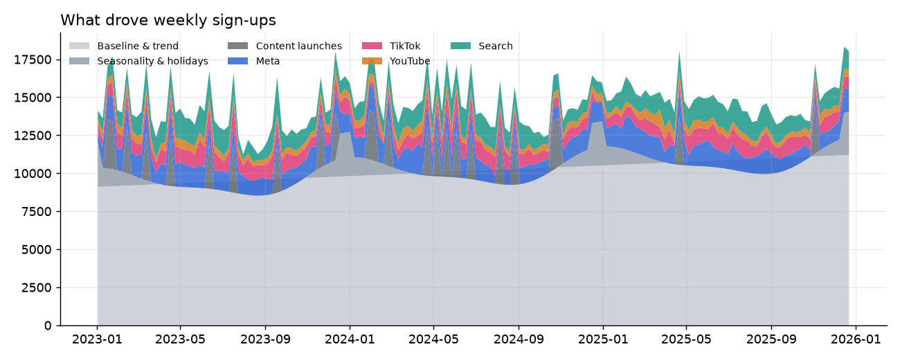
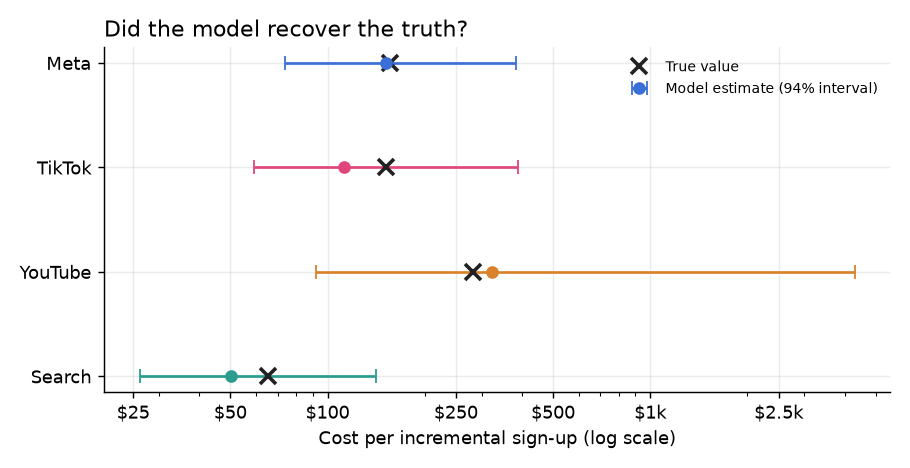
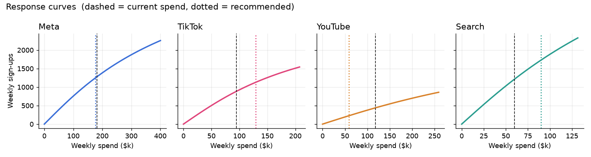
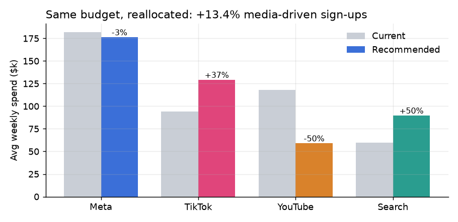

# Marketing Mix Model for a Streaming Service

A Bayesian marketing mix model (MMM) that estimates how much each paid channel drives new
subscribers for **Lumen+**, a fictional streaming service, and recommends how to reallocate
the budget.

The data is **synthetic**, generated with known "true" channel effects. That makes it possible
to do something you can't do with real data: check whether the model actually recovers the truth.

## The question

Lumen+ spends about **$454k a week (~$24M a year)** across Meta, TikTok, YouTube and Search.
Which channels are really driving new subscribers, and how should the same budget be split?

## Approach

| Step | What it does |
|---|---|
| **Data** | 156 weeks of spend by channel, weekly new subscribers, content launches and holidays ([`generate_data.py`](src/generate_data.py)) |
| **Adstock** | Ads keep working after they run. Geometric adstock carries each week's effect into the following weeks. |
| **Saturation** | Each extra dollar brings fewer sign-ups. A logistic curve captures diminishing returns per channel. |
| **Controls** | Trend (organic growth), yearly seasonality, holidays and major content launches, so media isn't credited for sign-ups it didn't cause. |
| **Model** | Bayesian regression in [PyMC-Marketing](https://github.com/pymc-labs/pymc-marketing), sampled with NumPyro (4 chains × 1,000 draws) ([`fit_mmm.py`](src/fit_mmm.py)) |
| **Optimisation** | Uses the fitted response curves to find the split of the *same* budget that maximises sign-ups, with each channel limited to ±50% ([`analyze.py`](src/analyze.py)) |

## Results

### The model fits well
R² = 0.73 and average error of 4.8% per week. The remaining error is mostly noise built into the data.



### What drove sign-ups
Most sign-ups are baseline demand. Content launches create the big spikes, and paid media adds about 3,800 sign-ups a week.



### Did it recover the truth?
For all four channels, the true cost per sign-up falls inside the model's 94% interval.

| Channel | True cost per sign-up | Model estimate | 94% interval |
|---|---|---|---|
| Search | $66 | $50 | $26 – $141 |
| TikTok | $152 | $113 | $59 – $388 |
| Meta | $156 | $151 | $74 – $385 |
| YouTube | $282 | $324 | $92 – $4,301 |



### Where to move budget
Search and TikTok are still on the steep part of their response curves. YouTube is the least efficient channel.



Reallocating the **same budget** (Search +50%, TikTok +37%, Meta −3%, YouTube −50%) is estimated
to lift media-driven sign-ups by **~13%**, or about **26,000 extra subscribers a year**.



## What I'd do next with real data

- **Test before moving money.** YouTube's estimate is very uncertain ($92 – $4,301 per sign-up), and the optimiser hits the ±50% limits for YouTube and Search. Before cutting YouTube in half, I'd run a **geo-lift test** (pause YouTube in a few matched regions) to confirm its incremental effect.
- **Calibrate the model with experiments.** Feed holdout and lift-test results into the model as priors, so the MMM and experiments agree.
- **Account for brand effects.** YouTube may build long-term awareness that a weekly sign-up model under-credits. The model's adstock estimate for YouTube (0.34 vs a true 0.60) shows how hard long carry-over effects are to recover.
- **Check stability.** Refit on rolling time windows to see whether recommendations hold over time.

## Run it yourself

```bash
python -m venv .venv
.venv/Scripts/activate        # macOS/Linux: source .venv/bin/activate
pip install -r requirements.txt
python src/generate_data.py   # creates data/lumen_weekly.csv
python src/fit_mmm.py         # fits the model (~1 minute)
python src/analyze.py         # writes charts and outputs/results.json
```

## Notes

- All data is simulated. Lumen+ is fictional and no real company data is used.
- Built by Michael Phamvu with help from AI coding tools.
